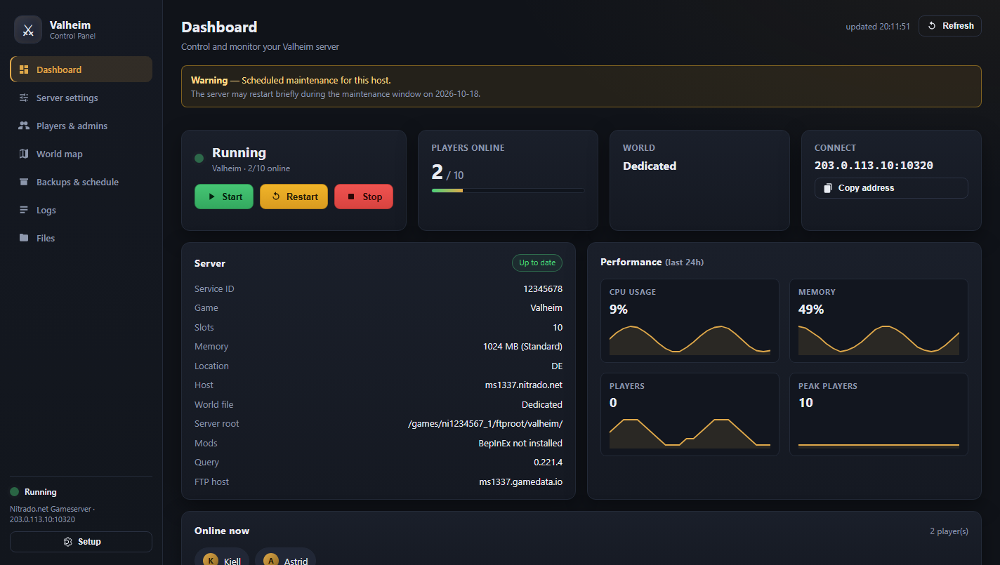
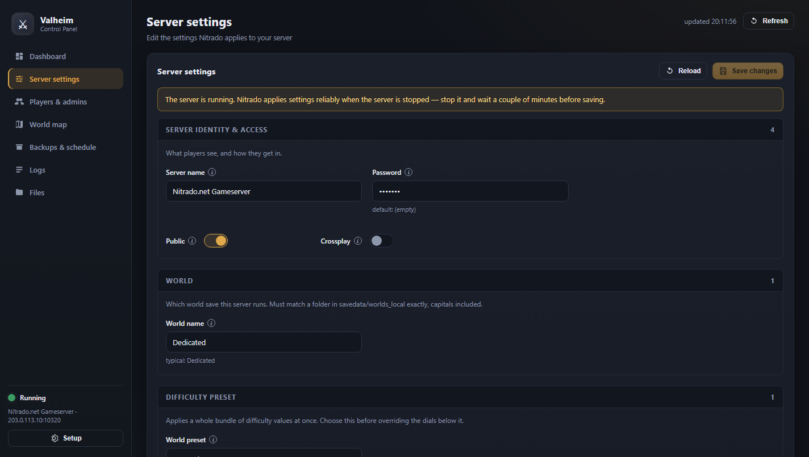
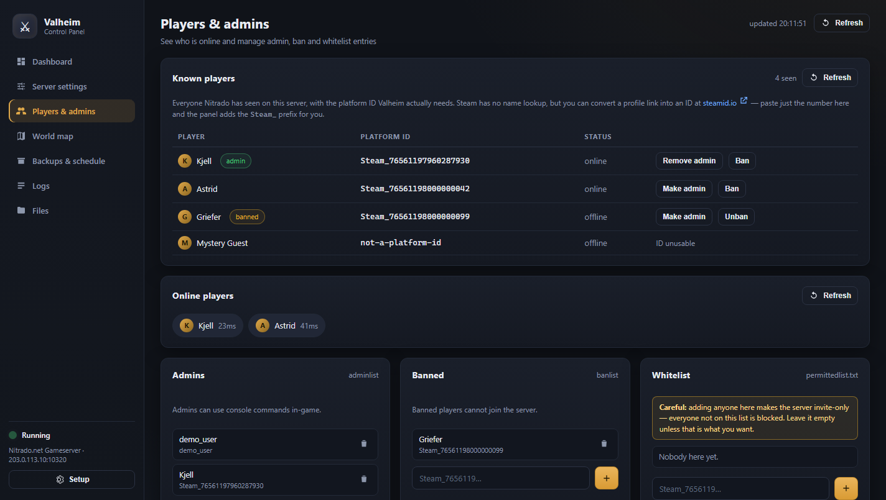

# Valheim Control Panel (Nitrado)

Run your Nitrado-hosted Valheim server from a tidy local web panel instead of
clicking through the Nitrado website. Start and stop the server, change its
settings, manage admins and bans, watch the world map, take backups, read the
logs and edit server files — all from one page in your browser.

It runs entirely on your own PC. Your Nitrado API token never leaves the machine
except when the panel talks to Nitrado on your behalf.


**New here? Go straight to [Quick start](#quick-start).**



*The dashboard, captured against the built-in demo data — see
[demo mode](#trying-it-without-a-nitrado-account-demo-mode).*

---

## Contents

- [What you get](#what-you-get)
- [Quick start](#quick-start)
- [Starting the panel without a terminal](#starting-the-panel-without-a-terminal-windows)
- [Using the panel](#using-the-panel)
- [Everyday tasks](#everyday-tasks)
- [Things worth knowing about Valheim](#things-worth-knowing-about-valheim)
- [The world map](#the-world-map)
- [Setting up the live map (optional)](#setting-up-the-live-map-optional)
- [Security and your token](#security-and-your-token)
- [Troubleshooting](#troubleshooting)
- [For developers](#for-developers)
- [License](#license)

---

## What you get

Everything is organised into seven tabs down the left side.

| Tab | What it is for |
| --- | --- |
| **Dashboard** | The server at a glance: live status (running / stopped / restarting…), one-click **Start**, **Restart** and **Stop**, players online, the world and connect address, server facts, 24-hour CPU / memory / player charts, and any Nitrado warnings. |
| **Server settings** | Change the settings Nitrado exposes — server name, password, world, public, crossplay, the difficulty preset, the five modifier dials and the 13 world rules. Friendly names and dropdowns, no raw config keys. |
| **Players & admins** | Everyone Nitrado has seen, with their platform ID and one-click **Make admin** / **Ban**, plus the raw list files Valheim actually reads. |
| **World map** | A **live map** of your world with player positions, served by the ValheimOne plugin on your server, plus an offline map generated from your world seed for when the server is stopped. |
| **Backups & schedule** | The worlds in `worlds_local/`, Nitrado's world backups (with restore), and the cron-style scheduled tasks that handle daily restarts. |
| **Logs** | Nitrado's activity history, the server log files, and a reference of the in-game admin commands. |
| **Files** | Browse the server filesystem, open a text file, edit and save it, with shortcuts to `savedata`, `worlds_local` and the three player list files. |

---

## Quick start

You need three things:

1. A **Valheim server on Nitrado** (a *gameserver* service).
2. **Node.js 20 or newer** on the PC running the panel — grab it from
   <https://nodejs.org> if you do not have it.
3. A **Nitrado API token** (below).

### 1. Get a Nitrado token

1. Open the **Nitrado Developer Portal**:
   <https://server.nitrado.net/eng/developer/tokens>
2. Create a **long-life token**.
3. Tick the service permissions so every tab works: **general control**,
   **settings (read + write)**, **logs**, **file browser (read + write)** and
   **console**. Backups is optional.

The token stays on your PC and is only ever sent to Nitrado.

### 2. Install and start the panel

Open a terminal in the project folder and run:

```powershell
npm install
npm start
```

Then open <http://127.0.0.1:8420> in your browser.

### 3. Connect your server

The first time you open it, the panel asks for two things:

1. **Paste your Nitrado API token** and click **Save token**.
2. **Pick your server** from the list — the panel finds your game servers and
   preselects the Valheim one.

Click **Save & continue** and the dashboard loads. That is the whole setup.

> If no servers appear, your token is probably missing the **service**
> permission. Expand *"Can't see it? Enter the service ID by hand"* and paste the
> number from your server's Nitrado page URL (`…/services/1234567`).

### Prefer to configure without the browser?

Copy `.env.example` to `.env` and fill it in:

```
NITRADO_TOKEN=your-token-here
NITRADO_SERVICE_ID=123456
PORT=8420
HOST=127.0.0.1
```

Anything you enter in the panel is stored in `data/config.json` and takes
priority over `.env`.

---

## Starting the panel without a terminal (Windows)

You only need the terminal for the very first `npm install`. After that you can
launch the panel by double-clicking:

| File | What it does |
| --- | --- |
| **`Start Valheim Panel.vbs`** | Starts the panel with no console window and opens your browser. If it is already running it just opens the browser instead of starting a second copy. |
| **`Stop Valheim Panel.vbs`** | Stops the panel. Only the panel is stopped — other node processes are untouched. |
| **`Create Desktop Shortcut.vbs`** | Run once. Puts a **Valheim Control Panel** icon on your Desktop that starts everything. |

Run **Create Desktop Shortcut** once, then forget about the terminal entirely —
double-click the desktop icon and the panel opens in your browser.

### Start it automatically when you sign in

Copy the desktop shortcut into your Startup folder:

```
%APPDATA%\Microsoft\Windows\Start Menu\Programs\Startup
```

Paste that path into the Explorer address bar to open the folder, then drop the
shortcut in. The panel starts hidden and serves quietly in the background; open
<http://127.0.0.1:8420> whenever you want it.

### If something goes wrong

The launchers never fail silently. If the panel does not come up, you get a
dialog with the reason, and the full output is in **`data/launch.log`**. The
running server's own log is **`data/panel.log`**.

The panel also writes **`data/panel.pid`** while it is running, which is how the
stop script kills exactly the right process rather than every `node.exe` on the
machine.

---

## Using the panel

Click a tab in the sidebar to switch. The dot at the bottom-left of the sidebar
always shows the live server status, and **Refresh** (top-right) re-reads
everything.

### Dashboard

Your home base.

- **Start / Restart / Stop** — the three buttons under the status. A restart
  takes a minute or two, and the status shows *restarting* while it happens.
- **Players online** — how many of the slots are in use right now.
- **World** and **Connect** — the active world name and the address players join
  on. Use **Copy address** to drop it into Discord.
- **Server** — a factual summary: region, slots, game version, FTP host and so on.
- **Performance (last 24h)** — CPU, memory and player-count charts.
- **Online now** — who is connected this moment.
- Any Nitrado warning or maintenance notice appears as a banner at the top.

### Server settings

All the Valheim settings Nitrado lets you change, grouped into sections and
labelled in plain English. Hover any setting for a short explanation; settings
with fixed choices become dropdowns that describe each option.

1. Change whatever you want — the bar at the bottom appears once something is
   *dirty*.
2. Click **Save changes**. The panel saves each setting in turn and tells you if
   any failed.
3. If the server is running, the panel warns you: Nitrado applies most settings
   **on the next start**, so the reliable order is **stop → wait a minute → save
   → start**.
4. **Discard** throws away your edits; **Reload** re-reads the current values.

The **password** is validated live: Valheim needs at least 5 characters, must
not contain the server name, and a *public* server needs a non-empty password.
The panel blocks saving until it is valid.



### Players & admins

Everyone who has joined, with the platform ID Valheim actually needs.



- **Known players** — a table of names and IDs with **Make admin** / **Ban**
  buttons on each row.
- **Online players** — who is in right now.
- **Admins**, **Banned** and **Whitelist** — edit each list directly. Paste an ID
  and press **+** to add; the panel adds the `Steam_` prefix for you if you paste
  a bare number.
- **What Valheim actually reads** — the raw `adminlist.txt`, `bannedlist.txt` and
  `permittedlist.txt` files from `savedata/`. These are the source of truth if
  the API view disagrees.

> ⚠️ **The whitelist is an allowlist.** Adding a single name makes the server
> **invite-only** — everyone not on it is blocked. Leave it empty unless that is
> what you want.

**Restart the server after editing** any of these lists so Valheim picks them up.

### World map

Two maps with different jobs — full details in [The world map](#the-world-map).

- **Live map** — real-time player positions from the ValheimOne plugin. Tick
  **Fog of war** to hide what players have not uncovered, **Refresh** to
  reconnect, or **Open in new tab**.
- **Offline map** — press **Generate** to draw the whole world from your seed in
  your browser. Works with the server stopped, but it is static. **Copy seed**
  copies the seed if you want to share it with the [valheim-map.world](https://valheim-map.world) site yourself.
- **Modifiers recorded in the world file** — what the world has actually baked
  in. If it disagrees with Server settings, the server has not been restarted
  since you saved those settings.

### Backups & schedule

- **Worlds** — every world folder in `savedata/worlds_local/`, with sizes and
  timestamps. The **World name** under Server settings must match a folder here
  exactly.
- **World backups** — Nitrado's own backups. The panel can list and **restore**
  them, but cannot create one on demand — use the Nitrado website for that.
- **Scheduled tasks** — the cron jobs Nitrado runs, including your daily restart.
  Add one with the action, hour, minute and optional message, then click
  **Add daily**.

### Logs

- **Server console** — live console output and command box, *if* the live map
  plugin is installed. Vanilla Valheim has no command channel.
- **Server log** — pick a log file from the dropdown and leave **Auto-refresh**
  ticked to follow it.
- **Activity log** — Nitrado's history of what was done to the service, newest
  first, with **‹ Newer** / **Older ›** paging.

### Files

A file browser for the whole server.

- Navigate with the folders, use **↑ Up** to go back, and the quick shortcuts to
  jump to `savedata`, `worlds_local` or a player list.
- Click a text file to open it in the **Editor**, change it, then **Save file**.

Editing a file that the server is using is safest with the server **stopped**.

---

## Everyday tasks

Quick recipes for the things you will actually do.

**Start, stop or restart the server** — Dashboard → **Start** / **Restart** /
**Stop**.

**Give a friend the join address** — Dashboard → **Copy address**.

**Rename the server** — Server settings → change **Server name** → **Save
changes** → restart the server.

**Change the password** — Server settings → **Password** → **Save changes** →
restart. (At least 5 characters, and it must not appear inside the server name.)

**Make someone an admin** — Players & admins → find them under *Known players* →
**Make admin**, or add their ID under **Admins** → restart.

**Ban or unban a player** — Players & admins → **Ban** on their row, or add /
remove the ID under **Banned** → restart.

**Make the server invite-only** — add the allowed players under **Whitelist** in
Players & admins. Anyone not listed is blocked.

**Switch worlds** — set **World name** (Server settings) to an existing folder
from the Backups tab, then restart. Changing the setting does not create the
world until the next start.

**Set a daily restart** — Backups & schedule → **Scheduled tasks** → pick the
action, hour and minute → **Add daily**.

**Keep a local copy of your world** — run `node tools/pull-world.mjs`. It
downloads a full copy of `savedata/` into `data/world-backup/`, read-only.

**Restore a Nitrado backup** — Backups & schedule → **World backups** → restore.
Stop the server first.

**Read the logs** — Logs tab. Pick a file under *Server log*, or browse Nitrado's
history under *Activity log*.

---

## Things worth knowing about Valheim

These were verified against a real Nitrado Valheim server, and they are the
things that trip most people up.

- **Restart to apply.** Nitrado applies most settings changes on the next server
  start. Stop the server, wait a minute or two, save, then start again.
- **Settings save one at a time.** The Nitrado API only accepts a single setting
  per request, so the panel saves them in sequence and reports any that failed.
- **Valheim has no RCON.** Admin commands (`save`, `kick`, `ban`,
  `setworldmodifier`, `setworldpreset`, `resetworldkeys`) go through the F5
  console in-game, or — with the live map plugin — its browser console.
- **Cheat commands do not work on dedicated servers**, admin or not. `spawn`,
  `god` and `fly` are refused by vanilla; only a mod unlocks them.
- **Player IDs need a platform prefix**: `Steam_76561197960287930`, not a bare
  17-digit number, and it is case-sensitive. The panel adds the prefix for you.
- **The whitelist blocks everyone else** — adding one name makes the server
  invite-only.
- **Valheim worlds are folders**, not `.db`/`.fwl` pairs:
  `savedata/worlds_local/<WorldName>/`. If **World name** does not match a folder
  exactly, the server silently generates a fresh world under that name instead of
  failing — the Backups tab warns you when it does not match.
- **World modifiers use `default`**, not `normal`, to mean "let the preset
  decide".
- **Daily restarts are a scheduled task**, not a setting.
- **Backups can be listed and restored, but not created** through the API.
- **Log paths come from Nitrado.** If your server reports none, choose
  *Custom path…* and enter something like
  `/games/<username>/ftproot/valheim/valheim-server.log`.
- **Rate limits.** Nitrado throttles at 429 and occasionally returns 503 during
  maintenance; the panel retries automatically and shows a banner if it cannot
  recover.

---

## The world map

The **World map** tab has two maps with different jobs.

### Live map (ValheimOne, server-side)

The primary map is served by the **[ValheimOne](https://github.com/humangenome/ValheimOne)**
BepInEx plugin running on your server. It re-draws from your world seed and
updates in real time — player positions, and optionally ships, carts, portals
and tombstones. It works with **vanilla clients**; players install nothing.

The panel reaches it two ways, both server-side: `GET /api/livemap` for the
status and player summary, and a **localhost proxy** that serves the map itself
into the tab. Neither the browser nor the URL ever carries the token. The mod
serves on its own TCP port (default **8790**) — not the game or query ports,
which are UDP.

**Player dots depend on in-game sharing.** ValheimOne respects each player's
"visible to other players" map setting, so players who have switched it off do
not appear.

### Seeing only what players have uncovered

Fog of war is a built-in plugin setting, controlled with **`tools/set-fog.mjs`**:

| Mode | What the map shows |
| --- | --- |
| `off` | the entire world |
| `trails` | only where players have walked |
| `explored` | trails **plus** anything revealed through cartography tables — closest to the in-game map |

```powershell
node tools/set-fog.mjs explored        # hide the unexplored world
node tools/set-fog.mjs explored --tint # translucent wash instead of a solid cover
node tools/set-fog.mjs off             # reveal everything again
node tools/set-fog.mjs                 # report the current setting
```

By default the unexplored area is a **solid cover** that also withholds region
names, spawn and trader markers until somewhere is explored. `--tint` leaves the
terrain faintly visible instead. The panel shows the active mode in the map
tab's stat chips (`Fog of war: explored · hidden`).

**Restart the server** for a change to take effect — the plugin reads its config
at startup. The live state is also served at `/api/status` under `map.fog`, so
the panel reports it rather than guessing.

**A fresh world will look nearly empty.** Fog shows what has been explored, so
until players have actually covered ground the map is almost entirely blank.
`Explored 0%` means exactly that — the feature working, not a fault.

**The map is locked behind an access token.** Without it, the port returns
`401 unauthorized` for the map page, every API and the console. See
[Setting up the live map](#setting-up-the-live-map-optional) below for how it is
set up, and what it does and does not protect against.

### Offline map (seed only)

Secondary, and only generated when you press **Generate**: your browser draws
the whole world from the seed via the third-party site
[valheim-map.world](https://valheim-map.world). No mod needed and it works with
the server stopped, but it is static — no players. Your seed is sent to that
site when you use it.

The seed comes from the world's metadata file (`_main.N.fwl2`, ~200 bytes). If
the configured World name has no folder yet — changing the setting does not
create the world until the next start — the tab falls back to the world actually
on disk and says so.

---

## Setting up the live map (optional)

Everything else works without this. The live map needs the **ValheimOne**
plugin, which needs BepInEx, and BepInEx's Linux doorstop has to be **preloaded
into the server process** — which Nitrado controls. Uploading BepInEx over FTP
alone does **not** work; this was tested. Nitrado's own addon is the supported
route:

1. In Nitrado, install the **`valheim_bepinex`** addon (not `valheimplus`, which
   also changes gameplay).
2. Start the server once. `BepInEx/LogOutput.log` appearing proves it loaded.
3. `node tools/install-mod.mjs --plugin-only` uploads just the plugin.
4. `node tools/set-livemap-token.mjs` generates the access token, saves it
   locally and writes it into the plugin's config. **Restart the server** for it
   to take effect.
5. The map is then at `http://127.0.0.1:8421` (the panel's local proxy), or in
   the World map tab.

`tools/install-mod.mjs` also takes `--list` to preview and `--remove` to undo
exactly what it uploaded.

ValheimOne leaves **every gameplay feature disabled by default** — only
`[Server]` and the map are on — so the world stays vanilla.

**The map is locked behind a token.** ValheimOne has no user accounts — only
shared secrets — and its port is reachable from the internet, so the token is
the whole security model:

| Request | Without token |
|---|---|
| The map page | `401 unauthorized` |
| `/api/status`, `/api/players` | `401 unauthorized` |
| `/api/console/exec` (kick/ban/save) | `401 unauthorized` |

`tools/set-livemap-token.mjs` generates a 32-character token, saves it to
`data/config.json`, and writes it into `valheimone.cfg` along with
`PublicView = false` so nothing on that port works without it.

**The token never reaches your browser.** ValheimOne's map uses absolute asset
paths and Server-Sent Events, so the panel runs a small localhost-only proxy on
port **8421** that forwards to the map and attaches the token as an
`X-LiveMap-Token` header. The map tab points at the proxy, which is why the
token stays out of your browser history, screenshots and referrer headers.
(`LIVEMAP_PROXY_PORT` overrides 8421, `LIVEMAP_PORT` overrides 8790.)

**What this does not give you.** There is no per-person identity: one token
grants admin to whoever holds it, there is no audit trail of who ran what, and
rotating the token is the only revocation. Real per-user login tied to
`adminlist.txt` would need a mod feature that does not exist. Adding a login
page in front of a proxy would be pointless, because anyone who knows the
server IP can bypass the proxy and talk to the mod directly.

Narrow `ConsoleWhitelist` in `valheimone.cfg` if you want a smaller command set —
it is `vo save kick ban unban banned lodbias sleep` by default.

### Why the admin view ignored the fog setting

This is a genuine trap worth documenting. Setting `FogMode` alone was **not
enough**: ValheimOne has *two* fog layers. The public view gets `fog`, which
**defaults to on**. The admin view gets a separate `adminFog` — labelled **"Fog
preview"** in the map's Layers panel — which **defaults to off**, and is stored
in the browser's `localStorage` rather than on the server.

The panel connects as **admin** (it holds the access token), so it got the
unfogged view and made the server-side setting look broken. **The panel fixes
this for you:** its proxy injects a two-line script into the map page that seeds
`adminFog` before the app boots, so the map matches the server's fog mode without
you touching the map's controls. You can flip it from the **Fog of war** checkbox
on the World map tab; the setting lives in `data/config.json` as
`liveMapAdminFog` and defaults to on.

You can also tick "Fog preview" yourself in the map's Layers panel — but it is
per-browser, so it resets if you clear site data, and the panel's injection is
what makes it reliable.

---

## Security and your token

There are **two separate tokens**, and it is worth keeping them distinct:

| Token | What it protects |
| --- | --- |
| **Nitrado API token** | Your whole Nitrado account, via the panel. |
| **Live map token** | The ValheimOne map port on your game server. |

Both are stored in `data/config.json`, which is git-ignored. The live map token
is covered under [Setting up the live map](#setting-up-the-live-map-optional);
the rest of this section is about the Nitrado one.

- The panel binds to `127.0.0.1` by default, so only this PC can reach it.
- The Nitrado token is sent only to `api.nitrado.net`, from the server side — the
  browser never sees it.
- Neither token is **encrypted at rest**. Anyone who can read `data/config.json`
  can read both. See below for how to live with that.

### Where the token is stored

When you paste a token into the panel it is written to **`data/config.json`** in
the project folder, and read back on every start. That file is git-ignored. It
survives restarts, updates and reboots — there is nothing else to set up.

If you would rather keep no token on disk, use the environment instead:

1. Delete `data/config.json` (or just its `token` line).
2. Copy `.env.example` to `.env` and set `NITRADO_TOKEN=...`.

Environment variables are only used as a fallback, so a token saved in the panel
always wins. To switch to `.env`, clear the file first.

### Locking the file down

On Windows, Node's `0600` file mode is **not** honoured — the file inherits the
permissions of the folder it sits in, so another local user account may be able
to read it. To restrict it to your account only:

```powershell
icacls "data\config.json" /inheritance:r /grant:r "$env:USERNAME:(R,W)"
```

On macOS and Linux the file is created with owner-only permissions already.

Either way, the token is **long-lived but revocable**: if you ever think it
leaked (a screenshot, a shared folder, a backup), delete it in the
[Nitrado Developer Portal](https://server.nitrado.net/eng/developer/tokens) and
generate a new one. The panel just asks for the new token.

If you ever want to reach the panel from another machine, change `HOST`, and put
it behind a reverse proxy with authentication first — the panel itself has no
login.

### Sharing this project

The code is safe to share — no secrets are committed, and `data/` is git-ignored.
When you pass the project on, always do it through Git (`git clone`, or a Git
archive):

```powershell
git archive --format=zip -o valheim-panel.zip HEAD
```

**Do not zip and send the working folder.** The git-ignored `data/` directory is
still physically there and contains your saved tokens in **`data/config.json`**
and your FTP password in **`data/ftp.json`** — a plain folder copy would include
them. If you have already shared a folder that contained `data/`, treat both
tokens as leaked and regenerate them: the Nitrado token in the
[Nitrado Developer Portal](https://server.nitrado.net/eng/developer/tokens), and
the live map token with `node tools/set-livemap-token.mjs`.

---

## Troubleshooting

**"The provided access token is not valid"** — regenerate a long-life token and
update it via the **Setup** button in the sidebar.

**It asks for my token again after a restart** — the panel prints where it looks
for the token on startup:

```
  settings file: C:\...\data\config.json
  token:    loaded (saved in the panel)
```

If it says `NOT set`, check that `data/config.json` still exists and contains a
`token` line. If it says the file could not be read, the panel will have kept the
broken file as `config.json.unreadable-<timestamp>` and shown an orange warning in
the Setup screen — paste your token again and it will be rewritten.

A token can go missing if the file was deleted, the folder is inside a sync
service (OneDrive and friends) that rolled it back, or it was hand-edited into
invalid JSON. The panel no longer treats an unreadable file as "no token saved",
so a loss is now always reported rather than silent.

**Want the token out of the project folder entirely?** Point `NITRADO_DATA_DIR`
at somewhere else, or use `NITRADO_TOKEN` in `.env` instead (and delete
`data/config.json`).

**No servers appear in the picker** — the panel loads them automatically once the
token is saved, and jumps straight in if there's only one. If the list is still
empty, the token is probably missing the **service** permission. Expand
*"Can't see it? Enter the service ID by hand"* and paste the number from your
server's Nitrado page URL (`…/services/<strong>1234567</strong>`).

**Settings save but nothing changes** — stop the server, wait a couple of
minutes, save again, then start.

**A list card is empty** — that game/plan may not support the endpoint. Check
`GET /services/<id>/gameservers/games/players/lists` scopes on your token.

**Can't read a log file** — confirm the path exists in the Files tab and that
your token has the `ROLE_WEBINTERFACE_FILEBROWSER_READ` scope.

### Live map

**The map tab says the live map is unavailable.** The game server must be
running with the plugin loaded. After a restart the map's own web server takes
**30–90 seconds** to come up, because it regenerates the world texture first —
the game can be `started` while the map is still warming up. Press Refresh.

**Everything on the map port returns `401 unauthorized`.** That is the lockdown
working. If the panel cannot see the map either, the saved token does not match
the one in `valheimone.cfg` — run `node tools/set-livemap-token.mjs` again and
restart the server.

**The map loads but shows no players.** ValheimOne honours each player's
"visible to other players" setting on the in-game map (press `M`). A player with
that switched off will not appear, by design.

**`LIVEMAP_PROXY_PORT` is already in use.** Something else has port 8421. Set a
different one in `.env`, or start with `$env:LIVEMAP_PROXY_PORT="8422"`.

**A world is still listed that you deleted.** Delete the world's folder with
`node tools/delete-world.mjs <Name>`, then press Refresh in the Backups tab.
Nitrado's API caches the world list for about a minute.

---

## For developers

### Running the tests

```powershell
npm test
```

This boots the fake Nitrado API and the panel against it, then checks the main
endpoints answer with the shape the UI expects — no real account or network
access needed. It prints one line per check and exits non-zero on failure.

### Trying it without a Nitrado account (demo mode)

The repo ships a fake Nitrado API so you can try the panel without touching a
real server. In one terminal:

```powershell
npm run mock
```

In another:

```powershell
$env:NITRADO_BASE_URL="http://127.0.0.1:8490"; $env:NITRADO_TOKEN="test-token"; $env:PORT="8420"; npm start
```

Open <http://127.0.0.1:8420> — it will auto-pick the mock Valheim server.

### Customising the settings labels

The Settings tab does not show raw config keys. Every setting gets a friendly
name, a hover explanation, and — where only certain values are valid — a
dropdown that describes what each choice does.

That mapping lives in **`public/settings-schema.js`** and is just a list of
entries. To rename something, or explain a setting Nitrado reports that isn't
covered yet:

```js
my_setting: {
  aliases: ['my_setting', 'mySetting', 'My Setting'],  // any spelling Nitrado uses
  label: 'My setting',                                  // shown in the panel
  help: 'What it does, shown on hover.',
  type: 'enum',                                         // text | password | number | boolean | enum
  options: [
    { value: 'low',  label: 'Low',  help: 'Shown under the dropdown when picked.' },
    { value: 'high', label: 'High', help: 'Shown under the dropdown when picked.' },
  ],
},
```

Aliases are matched with punctuation and case ignored, so one entry covers
`save_interval`, `saveInterval` and `Save Interval`. Save the file and refresh —
no restart, no build step.

Two safety rules worth knowing:

- **Nitrado's own option lists win.** If a setting arrives with an `options`
  array attached, the panel builds a dropdown from it automatically, even for
  settings this file has never heard of.
- **An unrecognised value is never hidden.** If a setting is meant to be a
  dropdown but its stored value isn't one of the known choices, the panel falls
  back to a plain text field rather than silently changing your setting to
  something else.

Anything not listed still renders with a tidy name generated from the key and a
"no description yet" tooltip, so nothing is ever invisible.

### Where the icon comes from

`assets/panel.ico` is generated, not hand-drawn — `npm run icon` regenerates it
from `tools/make-icon.mjs` at 256/64/48/32/16 px. Edit the geometry in that file
if you want a different mark.

### Project layout

```
server/
  index.js        Express app: /api routes, file read/write, settings batching,
                  plus the localhost proxy in front of the live map
  nitrado.js      Thin NitrAPI client (auth, retries, transfer URLs)
  store.js        data/config.json persistence (Nitrado token + live map token)
public/
  index.html      Markup
  styles.css      Dark Valheim-ish theme
  app.js          All front-end logic (no build step)
  settings-schema.js  Friendly names, hover help, dropdown options and sections
tools/
  launch.mjs      Starts the panel detached and opens the browser
  stop.mjs        Stops the panel via data/panel.pid
  make-icon.mjs   Generates assets/panel.ico
  pull-world.mjs  Downloads a full local copy of savedata/ (world + list files)
  install-mod.mjs Uploads a BepInEx mod release over FTP; --list, --plugin-only,
                  --remove
  set-livemap-token.mjs  Generates the live map token and writes the plugin config
  set-fog.mjs            Sets the live map's fog of war (off / trails / explored)
  delete-world.mjs       Deletes an inactive world, refusing if it is the active
                         one or is not backed up
assets/
  panel.ico       Desktop shortcut icon (generated)
  icon-preview-256.png  Same icon as a PNG, for previewing
  screenshots/    The images used in this README
test/
  mock-nitrado.mjs  Fake Nitrado API shaped like a real Valheim service
  smoke.mjs         End-to-end smoke test, run by `npm test`
  discover.mjs      Read-only probe: dumps real API responses to data/discovery
```

Runtime files, all under the git-ignored `data/`:

```
data/config.json    Nitrado token, service id, live map token
data/ftp.json       FTP credentials, written by the tooling above
data/world-backup/  Local world copies from tools/pull-world.mjs
data/panel.log      Running server output
data/launch.log     Launcher output, shown in a dialog if startup fails
data/panel.pid      Which process is the panel
data/discovery/     Raw API responses from tools/discover.mjs
```

---

## License

[MIT](LICENSE) © 2026 kiwicro.

Bundled third-party software is not part of this project: the optional live map
is the [ValheimOne](https://github.com/humangenome/ValheimOne) plugin, and the
offline map uses [valheim-map.world](https://valheim-map.world). Each keeps its
own license.
